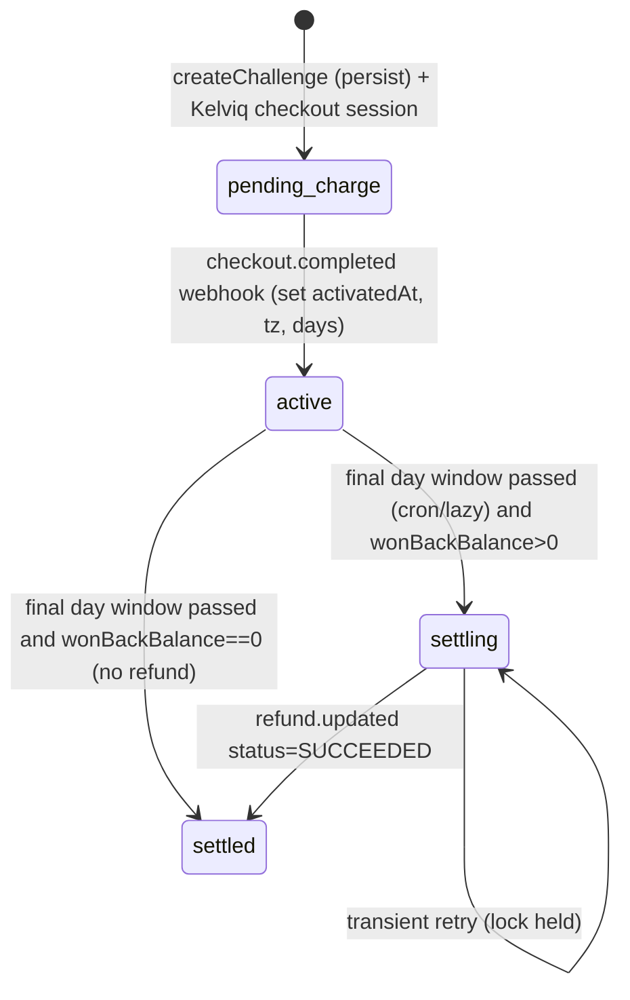
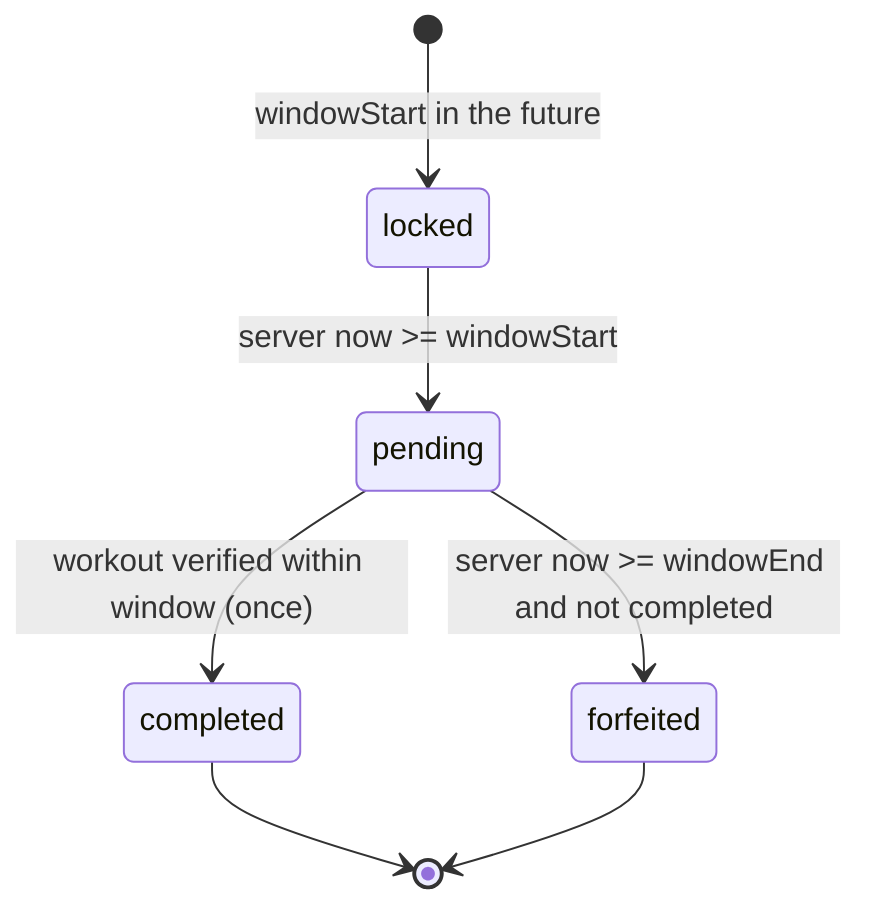

# Habit-Stakes — Design

> Companion to `requirements.md` (locked). All decisions here trace to the requirements and the
> verified APIs cited inline.

## 1. Architecture overview

Browser/React (TanStack Start) + Vercel serverless. Two trust domains:

- **Client (browser):** camera capture, MediaPipe rep counting, UI. Cannot be fully trusted for
  verification, so it only *proposes* a completion; the server *decides*.
- **Server (Vercel serverless, TanStack server functions + API routes on Nitro):** Better Auth,
  Kelviq checkout creation, webhook verification, day-window computation, completion acceptance,
  the single-settlement refund, and a cron sweep. Postgres (Neon) via Drizzle is the source of
  truth — never `localStorage` for money state.

```
Browser                Vercel serverless (Nitro)            Kelviq (MoR)        Neon Postgres
--------               --------------------------           ------------        -------------
camera + MediaPipe  ->  /api/workout/complete (server fn)                       challenge/day/
counts reps             validates window+ownership          checkout.session     verification/
                        -> marks day COMPLETED                                  kelviq_event
setup form  --------->  createChallenge (server fn)
                        -> Kelviq checkout.session  ----->   hosted checkout
                        redirect                         <--- checkoutUrl
                        /api/webhooks/kelviq (raw body) <--- checkout.completed
                        validateEvent -> activate                                persist
                        /api/cron/settle (Vercel Cron) -->  refunds.create  <--- (orderId)
                                                  <------  refund.updated(SUCCEEDED)
```

## 2. Module / file structure

Keeps the existing `#/*` → `./src/*` alias and TanStack file-based routing. Demo-only code
(`coffin-card`, `history/demo-controls`, `ledger-events`, `money-summary`, the localStorage
`commitment.ts` ledger, `formatINR`, `plan-gate`, `reset-demo`, setup/commitment-form demo) is
removed. Kept scaffolding: router, `db.ts`, `db/schema.ts`, `use-camera-recorder.ts` (refactored
to feed a live `<video>` to MediaPipe), `components/ui/*`, Tailwind theme, vitest.

```
src/
  lib/
    auth.ts                     Better Auth instance (server)
    auth.functions.ts           getSession / ensureSession server fns
    auth.client.ts              authClient (Google + magic-link)
    kelviq/client.ts            @kelviq/node-sdk singleton (server-only)
    kelviq/checkout.ts          createCommitmentCheckout(challenge)
    kelviq/webhook.ts           validateEvent + dispatch
    kelviq/refund.ts            settleChallenge(challengeId)
    challenge/
      math.ts          pure: totals, invariant checks            (unit-tested)
      windows.ts       pure: day windows from activatedAt+tz+startDayOffset (unit-tested)
      state.ts         pure: day/challenge state transitions      (unit-tested)
      settlement.ts    pure: idempotent settlement decision       (unit-tested)
    server/
      challenges.functions.ts   createChallenge, getDashboard, completeDay (server fns)
      webhooks.route.ts        /api/webhooks/kelviq (raw body)
      cron.route.ts            /api/cron/settle (Vercel Cron)
    vision/
      engine.ts               FilesetResolver + Pose/Hand landmarker lifecycle
      rep-counter.ts          generic rep state machine (angle/threshold cycles)
      exercises/
        squat.ts  push-up.ts  jumping-jack.ts   custom-gesture.ts
      liveness.ts             anti-cheat: frame continuity, rate, confidence
      index.ts                registry: exerciseKey -> module
  routes/
    index.tsx  setup.tsx  dashboard.tsx  record.tsx  history.tsx  __root.tsx
    api/auth/$.ts             Better Auth handler
    api/webhooks/kelviq.ts     webhook route
    api/cron/settle.ts         settlement sweep
  db/schema.ts                Drizzle (Better Auth tables + new tables, drop dodo/todo)
  components/                 app-shell, setup form, dashboard, rep-count UI, ledger
public/wasm/                  @mediapipe/tasks-vision wasm + model .task (self-hosted)
.kiro/
  hooks/                      vision test-on-save hook (createHook)
  steering/                   architecture, vision-conventions, kelviq, testing
  specs/habit-stakes/         this spec
vercel.json                   + crons: hourly /api/cron/settle
```

## 3. Data model (Drizzle, existing `appSchema`)

Keep Better Auth core: `user`, `session`, `account`, `verification`. **Drop** the
DodoPayments-template `subscription` and `todo`. Add `kelviqCustomerId` to `user`.

New tables:

- `challenge`
  - `id` uuid pk; `userId` text fk→user.id; `exerciseType` enum(squat,push_up,jumping_jack,custom);
  - `customGesture` text nullable (pinch|fist|open_hand); `targetReps` int; `targetSets` int;
  - `dailyStakeAmount` int (USD dollars); `totalDays` int; `totalCommitmentAmount` int (dollars);
  - `status` enum(pending_charge, active, settling, settled);
  - `timezone` text (IANA, pinned); `activatedAt` timestamptz (UTC, set on checkout.completed);
  - `startDayOffset` int (0=Today, 1=Tomorrow); `day1LocalDate` date (computed);
  - `kelviqCheckoutSessionId` text; `kelviqOrderId` text; `kelviqCustomerId` text;
  - `settlementStatus` enum(pending, settled, none); `settlementRefundId` text **unique**;
  - `settledAt` timestamptz; `createdAt`/`updatedAt`.
  - Unique partial index on `settlementRefundId` (non-null) → enforces at-most-one refund at the DB.
- `day`
  - `id` uuid pk; `challengeId` fk; `dayNumber` int (1..totalDays); `localDate` date;
  - `windowStartUtc` timestamptz; `windowEndUtc` timestamptz (deadline);
  - `status` enum(locked, pending, completed, forfeited); `completedAt` timestamptz;
  - Unique(`challengeId`,`dayNumber`); index(`status`).
- `workout_verification` (audit completion record)
  - `id` uuid pk; `challengeId` fk; `dayNumber` int; `exercise` text; `setsCompleted` int;
  - `totalReps` int; `confidence` numeric; `durationSeconds` int; `recordedAt` timestamptz; `note` text.
  - Unique(`challengeId`,`dayNumber`) → a day is completed exactly once.
- `kelviq_event` (webhook idempotency + audit)
  - `eventId` text **unique** (Kelviq `webhook-id`/event `id`); `eventType` text;
  - `payload` jsonb; `processedAt` timestamptz.

All money stored in **whole USD dollars** internally (Kelviq calls convert to cents × 100).

## 4. Auth — Better Auth (Google + magic-link)

- `src/lib/auth.ts`: `betterAuth({ database: drizzleAdapter(db,...), secret: env.BETTER_AUTH_SECRET,
  socialProviders: { google: { clientId, clientSecret } },
  plugins: [magicLink({ sendMagicLink }), tanstackStartCookies()] })`.
  `tanstackStartCookies()` is last (per Better Auth + TanStack guide).
- `src/routes/api/auth/$.ts`: catch-all mounting `auth.handler` on GET/POST (confirmed pattern).
- `src/lib/auth.functions.ts`: `getSession`/`ensureSession` server fns via `getRequestHeaders`.
- Route protection via `beforeLoad` → `getSession` → redirect to `/login`; guarded routes under a
  `_protected` layout. `createChallenge` and `completeDay` server fns call `ensureSession`.
- Client: `createAuthClient({ plugins: [magicLinkClient()] })`; `signIn.social({provider:'google'})`
  and `magicLink.sendMagicLinkEmail({email})` → `magicLink.verifyEmail({token})`.
- Env: `BETTER_AUTH_SECRET`, `GOOGLE_CLIENT_ID`, `GOOGLE_CLIENT_SECRET`, magic-link email transport
  (`RESEND_API_KEY` or SMTP). Exact plugin import names verified at impl.

## 5. Challenge lifecycle & state machine



Day state machine (per `day` row):



Transitions are server-authoritative using **server UTC + stored timezone**, never the client
clock. `forfeited` is derived lazily on dashboard load and persisted; the cron sweep also flips
pending→forfeited for past days.

## 6. Day-window computation (`challenge/windows.ts`, pure, unit-tested)

Inputs: `activatedAt` (UTC), `timezone` (IANA), `startDayOffset` (0|1), `totalDays`. Use a
TZ-aware library (`@js-joda`/`temporal`/`Intl`) to compute local-day boundaries, then convert back
to UTC for storage. (DST is handled by computing each day's boundaries from its own local date, not
by adding 24h — adding 24h breaks on DST transitions.)

- `day1LocalDate = localDateInTz(activatedAt) + startDayOffset days`.
- For day `d` (1..totalDays): `localDate = day1LocalDate + (d-1)`;
  `windowEndUtc = toUtc(localMidnightStart(localDate + 1 day), tz)`;
  `windowStartUtc` = `activatedAt` for d=1 with offset 0, else `toUtc(localMidnightStart(localDate), tz)`.
- Precompute all `day` rows at activation: day 1 `pending` (or `locked` if offset 1), rest `locked`.

At activation the user chose **Today/Tomorrow** (OQ-1); `startDayOffset` captures it. After 20:00
local the UI preselects Tomorrow with an explanatory note.

## 7. Kelviq integration

**Checkout (`kelviq/checkout.ts`, server-only):** `client.checkout.createSession({
  planIdentifier: env.KELVIQ_COMMITMENT_PLAN_IDENTIFIER,   // one Kelviq product+one-time plan
  chargePeriod: "ONE_TIME",
  customAmount: totalCommitment,                          // USD major units (dollars)
  currencyCode: "USD",
  taxBehavior: "EXCLUSIVE",                               // tax added on top; pot = refundable order amount
  successUrl, metadata: { challengeId, userId }
})` → store `checkoutSessionId`, redirect to `checkoutUrl`.
> Correction vs. the original brief: a checkout session **requires** `planIdentifier` +
> `chargePeriod`; `customAmount` overrides the plan price per challenge. We must create one
> Kelviq product + one-time plan in the dashboard and put its identifier in env. `customAmount`
> is major units (dollars), confirmed against the refund `amount`(major)/`amountUnits`(minor) split.

**Webhook (`api/webhooks/kelviq.ts`):** raw body (`express.raw`-equivalent for TanStack), verify
with `validateEvent(body, env.KELVIQ_WEBHOOK_SECRET, headers)`; on `WebhookVerificationError`
return 400. Idempotency: insert into `kelviq_event(eventId)`; on unique-violation, ack 202 and stop.
Dispatch:
- `checkout.completed` → activate: set `status=active`, `activatedAt` = event time, `timezone`
  from the challenge (captured at setup), compute+insert all `day` rows. Read `data.object.metadata`
  for `challengeId`/`userId`; fetch the order id (retrieve checkout session → order, or from the
  follow-up `order.created`) and store `kelviqOrderId`.
- `order.created`/`order.updated` → link `kelviqOrderId` to the challenge if not yet set.
- `refund.updated` with `status=SUCCEEDED` (and `refund.created`) → set `settlementStatus=settled`,
  `settledAt`, `settlementRefundId` (refund uuid), challenge `status=settled`. Idempotent.
- `order.refunded` → informational (partial vs full); do not drive logic from it.

**Refund / settlement (`kelviq/refund.ts` + `api/cron/settle.ts`):** after the final day's window
ends, compute `wonBackBalance`. If >0:
1. Atomic `UPDATE challenge SET status='settling' WHERE id=? AND status='active' RETURNING *` — only
   one caller wins (DB-level lock). Losers stop.
2. `client.refunds.create({ orderId, amountUnits: wonBackBalance*100, reason:'REQUESTED_BY_CUSTOMER',
   internalNote: 'habit-stakes settlement' })` → refund uuid.
3. Store `settlementRefundId` (unique) + `settlementStatus=pending`, `status=settling`.
4. On `refund.updated SUCCEEDED` webhook → `settlementStatus=settled`, `status=settled`.
Recovery for a crash between steps 2–3: if `status=settling` with no `settlementRefundId`, list
Kelviq refunds for the order to find the existing refund and store it (no second create).
If `wonBackBalance==0`: set `settlementStatus=none`, `status=settled` (no refund call).
Vercel Cron (`vercel.json` `crons: [{ path:'/api/cron/settle', schedule:'0 * * * *' }]`) runs the
sweep hourly, guarded by `CRON_SECRET`; the dashboard also triggers a lazy check on load.

## 8. Workout verification (in-browser MediaPipe)

Engine (`vision/engine.ts`): `npm i @mediapipe/tasks-vision`; self-host the WASM + `pose_landmarker.task`
/`hand_landmarker.task` under `/public/wasm` (Vercel-friendly, no CDN dependency). `FilesetResolver.forVisionTasks('/wasm')`
→ `PoseLandmarker.createFromOptions(fileset,{baseOptions:{modelAssetPath,delegate:'GPU'},runningMode:'VIDEO',numPoses:1})`
(and `HandLandmarker` for custom). Per `requestAnimationFrame` call `detectForVideo(videoEl, performance.now())`
→ `result.landmarks[0]` (33 pose points; hand = 21). Landmark indices (confirmed): hip 23/24, knee
25/26, ankle 27/28, shoulder 11/12, elbow 13/14, wrist 15/16; hand thumb tip 4, index tip 8, wrist 0.

Rep modules (`vision/exercises/*.ts`) implement a common `RepModule` interface
(`{ init, onFrame(landmarks, ts): {repCounted, confidence, warn} }`) using a shared state machine in
`rep-counter.ts` (extended→flexed→extended cycle with hysteresis + min-duration):
- squat: knee angle (hip→knee→ankle); standing(>160°)→down(<140°)→standing = 1 rep.
- push-up: elbow angle (shoulder→elbow→wrist); up(>160°)→down(<100°)→up = 1 rep.
- jumping-jack: arm spread (wrist distance ÷ shoulder width, wrists above shoulders) + ankle
  distance; closed→open→closed = 1 rep.
- custom gesture (HandLandmarker): pinch = dist(tip4,tip8) < k·handSize; or fist/open-hand; one
  gesture cycle = 1 rep (selected at setup).

Anti-cheat (`vision/liveness.ts`): live `getUserMedia` stream only (no file/upload input); frame
continuity (timestamps must advance ~real-time; reject jumps/drops); max rep rate (reject >3 reps/s);
min rep duration; landmark visibility/confidence thresholds (pause counter + warn below threshold,
since `visibility`/`presence` can be absent in some builds — fall back to z/normalized depth).

Trust boundary: pose counting is client-side (MediaPipe can't run on Vercel serverless). Server
guards: `completeDay` requires a server-issued session nonce bound to the open day, validates the
day window by **server time**, and enforces a minimum wall-clock session duration consistent with
the rep count (measured server-side from session start → claim). The client submits
`{setsCompleted, totalReps, confidence, durationSeconds}`; server rejects if the day isn't `pending`,
the window is closed, or timing is implausible. This is honestly weaker than server-side CV — noted
as an accepted trade-off for serverless hosting.

## 9. Ledger & dashboard

Dashboard server fn returns `totalCommitmentAmount`, `wonBackBalance = (#completed)×stake`,
`forfeitedBalance = (#forfeited)×stake`, `remainingDays`, and per-day statuses. All money in USD,
whole dollars (display); the single refund amount is `wonBackBalance×100` cents.

## 10. InteractionKit DX port (`.kiro/hooks` + `.kiro/steering`)

- `.kiro/steering/architecture.md` — client/server split, where vision/Kelviq/auth logic lives.
- `.kiro/steering/vision-conventions.md` — how to add a new exercise: implement `RepModule`, register
  in `vision/index.ts`, add an anti-cheat + min-duration, and a unit test for the state machine.
- `.kiro/steering/kelviq.md` — server-only API key, `metadata` for `challengeId`/`userId`, raw-body
  webhook verification, idempotency by event id, at-most-once refund lock.
- `.kiro/steering/testing.md` — the invariant + state-machine tests that must stay green.
- `.kiro/hooks/vision-test-on-save.json` — `PostFileSave` matcher `src/lib/vision/.*\.ts` running the
  vision unit tests, so a rep module edit is validated immediately (created via `createHook`).

## 11. Tests (vitest, pure functions — the brief's required coverage)

- `challenge/math.ts`: totals math; invariant `wonBack+forfeited+remaining×stake = totalCommitment`.
- `challenge/windows.ts`: window boundaries across timezones + DST; Today vs Tomorrow start; late
  activation; day numbering.
- `challenge/state.ts`: locked→pending→completed|forfeited transitions; completed is irreversible;
  out-of-window completion rejected; sequential settling.
- `challenge/settlement.ts`: idempotent single-refund (only one `settling` win; refund once; none
  when `wonBackBalance==0`); recovery after crash; double-call rejected.
- `vision/exercises/*`: each rep state machine via synthetic landmark sequences (rep counted on a
  valid cycle, rejected on too-fast/no-confidence).

## 12. Environment variables (you provide later)

```
DATABASE_URL=postgres://...neon...
BETTER_AUTH_SECRET=
GOOGLE_CLIENT_ID=  GOOGLE_CLIENT_SECRET=
RESEND_API_KEY=                # magic-link email transport (or SMTP)
KELVIQ_SERVER_API_KEY=         KELVIQ_WEBHOOK_SECRET=
KELVIQ_ENV=sandbox             # default sandbox; production to go live
KELVIQ_COMMITMENT_PLAN_IDENTIFIER=   # the one-time plan created in the Kelviq dashboard
CRON_SECRET=                   # protects /api/cron/settle
```

## 13. Edge cases & risks

- **Refund window:** Kelviq docs state no hard refund-by date (bounded only by remaining refundable
  balance). If a processor window surfaces in practice, fallback is a pre-window sweep that refunds
  the balance-so-far and marks partial — not needed by current docs.
- **Crash between refund create and persist:** recover by listing Kelviq refunds for the order.
- **Clock spoofing:** all deadlines/wallets use server UTC + stored tz.
- **DST:** compute each day's boundaries from its own local date, not by 24h addition.
- **Kelviq setup dependency:** a product + one-time plan must exist in the Kelviq dashboard first.
- **MediaPipe model hosting:** self-host wasm + `.task` in `/public/wasm` for reliability.
- **Verification trust:** client-side CV is an accepted serverless trade-off; mitigated by server
  timing/ownership/window guards + liveness heuristics, not by re-running CV on the server.
