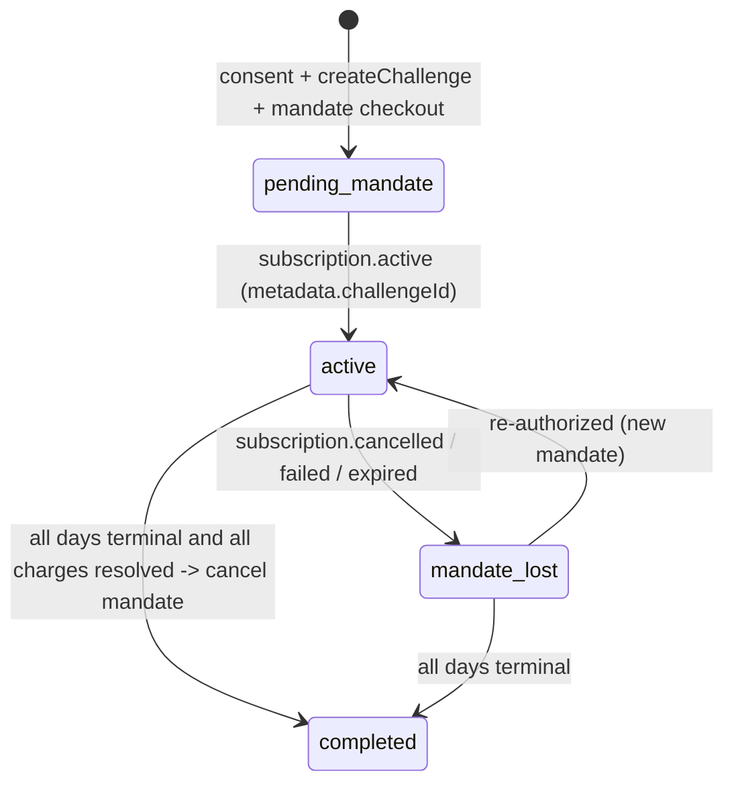

# Habit-Stakes - Design (v2: Dodo Payments, charge per missed day)

> Companion to `requirements.md` v2. Sections on auth, day windows and MediaPipe are unchanged
> from v1 and summarized only where they touch payments.

## 1. Architecture

```
Browser                    Server (TanStack Start on Vercel)              Dodo Payments
-------                    ---------------------------------              -------------
onboarding draft  ----->   startAccessCheckout (weekly | lifetime) ---->  hosted checkout
                                                                   <----  subscription.active /
                                                                          payment.succeeded
consent + mandate ----->   createChallenge -> stake mandate checkout --->  hosted checkout
                                                                   <----  subscription.active
record workout    ----->   completeDay (window + ownership + timing)
open app          ----->   getDashboard -> chargeMissedDays  -------->  subscriptions.charge
                                                                   <----  payment.succeeded/failed
                           /api/webhooks/dodo (raw body, unwrap, idempotent)
                           /api/cron/charge-missed (daily backstop, OQ-1)
```

Postgres (Neon) via Drizzle is the source of truth for every money state.

## 2. Files

Removed:

- `src/lib/kelviq/*` (client, checkout, customers, refund, webhook + test)
- `src/routes/api/webhooks/kelviq.ts`
- `src/lib/server/settle.ts`, `src/lib/challenge/settlement.ts` + test, the settle cron route
- `.kiro/steering/kelviq.md`

Added:

```
src/lib/dodo/
  client.ts          DodoPayments singleton: bearerToken, environment, webhookKey (server-only)
  checkout.ts        createWeeklyCheckout, createLifetimeCheckout, createStakeMandateCheckout
  customers.ts       ensureDodoCustomer(user) -> customer_id (stored on user)
  charges.ts         chargeStake(), cancelMandate(), classifyDecline()
src/lib/challenge/
  charges.ts         pure: which days are due, retry schedule, hard-decline rules (unit-tested)
src/lib/server/
  stake-charges.server.ts   chargeMissedDays(userId, now) - claim, call Dodo, record
  webhook-handler.ts        rewritten for Dodo events
src/routes/api/webhooks/dodo.ts      raw body -> unwrap -> handler
src/routes/api/cron/charge-missed.ts daily backstop guarded by CRON_SECRET (OQ-1)
.kiro/steering/dodo.md               conventions (replaces kelviq.md)
```

Changed: `access.ts`/`access.server.ts` (Dodo plans), `challenges.server.ts`, `paywall.tsx`,
`setup-form.tsx` (consent screen, no pot/escrow copy), `dashboard-view.tsx`, `money-summary.tsx`,
`db/schema.ts`, `env.ts`, `.env.example`, `README.md`, `HANDOFF.md`, `architecture.md`.

## 3. Data model

`user`: drop `kelviqCustomerId`; add `dodoCustomerId text unique`.

`challenge`:

- Drop `kelviqCheckoutSessionId`, `kelviqCheckoutUrl`, `kelviqOrderId`, `kelviqCustomerId`,
  `totalCommitmentAmount`, `settlementStatus`, `settlementRefundId`, `settledAt`.
- Add `routine jsonb not null` (replaces the routine stored in `kelviqCustomerId`).
- Add `dodoSubscriptionId text unique`, `mandateCheckoutUrl text`.
- Add `consentText text not null`, `consentedAt timestamptz not null`.
- `status` enum becomes `pending_mandate | active | mandate_lost | completed`.
- Unique partial index "one live challenge per user" covers `pending_mandate, active,
mandate_lost`.

`day`: unchanged.

New `stake_charge`:

| column                | type        | notes                                            |
| --------------------- | ----------- | ------------------------------------------------ |
| id                    | text pk     |                                                  |
| challengeId           | text fk     |                                                  |
| dayNumber             | int         | unique with challengeId                          |
| amountCents           | int         | = dailyStakeAmount × 100                         |
| status                | enum        | `claimed, pending, succeeded, failed, abandoned` |
| dodoPaymentId         | text unique | set from the charge response                     |
| attempts              | int         |                                                  |
| firstAttemptAt        | timestamptz | anchors the retry schedule                       |
| nextAttemptAt         | timestamptz | null when no retry is due                        |
| lastDeclineCode       | text        |                                                  |
| createdAt / updatedAt | timestamptz |                                                  |

`user_subscription` (weekly): rename `kelviqSubscriptionId` → `dodoSubscriptionId`.

`lifetime_access`: rename `kelviqCheckoutSessionId` → `dodoPaymentId`; drop `kelviqOrderId`.

`kelviq_event` → replaced by `payment_event(webhookId unique, eventType, payload jsonb,
processedAt)`.

Migration drops Kelviq data (test data per D-1). It is generated, reviewed, and only run with
approval.

## 4. Challenge state machine



## 5. Missed-day charging

`chargeMissedDays(userId, now)` runs on `getDashboard` and from the daily cron:

1. Load the user's `active` challenge and days. Persist lazy `forfeited` status as today.
2. Due days = `forfeited` days with no `stake_charge` row, plus rows in `failed` whose
   `nextAttemptAt <= now` (pure `dueCharges()` in `challenge/charges.ts`).
3. For each due day, oldest first, at most one in flight per subscription (Dodo rejects a new
   charge with `409` while one is pending):
   - **Claim**: `INSERT stake_charge ... ON CONFLICT DO NOTHING RETURNING` inside a transaction
     that re-reads `day.status = 'forfeited'` with `FOR UPDATE`. A lost race returns nothing and is
     skipped. `completeDay` also takes the day row `FOR UPDATE`, so a completion and a charge claim
     can't both win.
   - **Charge**: `dodo.subscriptions.charge(subscriptionId, { product_price: amountCents,
product_currency: 'USD', product_description, metadata })` with request idempotency key
     `stake:{challengeId}:{dayNumber}:{attempt}`. Store `dodoPaymentId`, status `pending`.
   - **Errors**: `409` leaves the row `claimed` for the next run; `429` (too many failures) stops
     charging this subscription; other errors mark `failed` with a scheduled retry.
4. Webhooks settle the outcome (section 6).

Retry schedule (pure, tested): attempts at `firstAttemptAt + 0, 3, 10, 17` days, same time of day.
Hard declines are never retried. After attempt 4 fails the row becomes `abandoned`.

Each run is bounded (e.g. 10 charges) so a request can't time out on a long backlog.

## 6. Webhook handling (`/api/webhooks/dodo`)

- Read `await request.text()`, convert headers to a plain object, call
  `dodo.webhooks.unwrap(raw, { headers })`. Failure → 401 and a `[webhook]` log.
- In one transaction: insert `payment_event(webhookId)`; on a unique violation return 200 with no
  changes. Then dispatch:

| Event                                           | Effect                                                                                                                                                                              |
| ----------------------------------------------- | ----------------------------------------------------------------------------------------------------------------------------------------------------------------------------------- |
| `subscription.active`                           | `metadata.kind = stake_mandate`: activate the challenge (day rows, timezone). `weekly`: upsert `user_subscription` active/trialing. Re-authorized mandate: `mandate_lost → active`. |
| `subscription.renewed` / `plan_changed`         | weekly: update status and period end.                                                                                                                                               |
| `subscription.on_hold`                          | weekly: access off. stake mandate: informational (charges still allowed).                                                                                                           |
| `subscription.cancelled` / `failed` / `expired` | weekly: access off at period end. stake mandate: `active → mandate_lost` unless the challenge is ending.                                                                            |
| `payment.succeeded`                             | `kind = stake_charge`: row → `succeeded`. `kind = lifetime`: insert `lifetime_access`, then cancel any live weekly subscription after commit.                                       |
| `payment.failed`                                | `kind = stake_charge`: row → `failed`, store decline code, schedule retry or stop.                                                                                                  |

- Matching uses ids we stored (`dodoSubscriptionId`, `dodoPaymentId`) first and `metadata` second,
  so a forged-but-signed metadata value can't move another user's state.
- Returns 200 only after commit; a handler error returns 500 so Dodo retries.

## 7. Checkouts

All use `dodo.checkoutSessions.create` and redirect to `checkout_url`:

- Weekly: `product_cart: [{ product_id: DODO_WEEKLY_PRODUCT_ID, quantity: 1 }]`,
  `subscription_data: { trial_period_days: 3 }` on the first subscription only.
- Lifetime: `product_cart: [{ product_id: DODO_LIFETIME_PRODUCT_ID, quantity: 1 }]`.
- Stake mandate: `product_cart: [{ product_id: DODO_STAKE_PRODUCT_ID, quantity: 1 }]`,
  `subscription_data: { on_demand: { mandate_only: true } }`.
- Every session: `customer: { customer_id: user.dodoCustomerId }`, `return_url`,
  `metadata: { kind, userId, challengeId? }`.

Exact SDK field names and the idempotency request option are verified against
`dodopayments@2.63.1` types during implementation.

## 8. Access rules

Unchanged logic in `src/lib/access.ts`; only the data source moves to Dodo ids. Added rule:
`canStartChallenge` is false while the user owes a stake charge or has a `mandate_lost`
challenge.

## 9. UI changes

- Onboarding review step becomes the consent step: amounts, the FR-2 statement, an explicit
  checkbox, then "Authorize card". No "deposit", "pot" or "escrow" wording anywhere.
- Paywall: unchanged layout; prices from Dodo constants.
- Dashboard: charged so far, owed, remaining exposure, per-day charge badges, "Update card"
  when a charge failed, "Re-authorize" when the mandate is lost.

## 10. Tests (vitest, pure)

- `challenge/charges.ts`: due-day selection (only past forfeited, never completed/pending/locked),
  one charge per day, retry schedule at +3/+10/+17 days, hard-decline stop, 4-attempt cap,
  total ≤ maxExposure.
- `access.ts`: existing tests plus "owed charge blocks new challenge".
- Webhook: signature failure → 401, duplicate `webhook-id` → no-op (with a mocked db layer).
- Existing window, state and vision tests stay green.

## 11. Environment

```
DODO_API_KEY=              # Dodo dashboard -> Developer -> API keys (test key first)
DODO_WEBHOOK_SECRET=       # Developer -> Webhooks -> endpoint signing secret
DODO_MODE=test_mode        # live_mode to go live
DODO_WEEKLY_PRODUCT_ID=    # subscription product, $2/week
DODO_LIFETIME_PRODUCT_ID=  # one-time product, $9.99
DODO_STAKE_PRODUCT_ID=     # subscription product used for on-demand mandates
CRON_SECRET=               # protects /api/cron/charge-missed
```

Removed: every `KELVIQ_*` variable, and the two Kelviq signing secrets hardcoded in the old
webhook route.

## 12. Risks

- **Users who stop opening the app** are only charged by the cron backstop (OQ-1).
- **Chargebacks:** penalty charges invite disputes; the stored consent text and time are the
  evidence. Handle `dispute.*` events later if they occur.
- **Card testing flags:** retries follow Dodo's schedule; no bursts.
- **Mandate revoked mid-challenge:** later missed days can't be charged; accepted and shown.
- **Timezone gaming:** deadlines use the timezone pinned at activation, as before.
